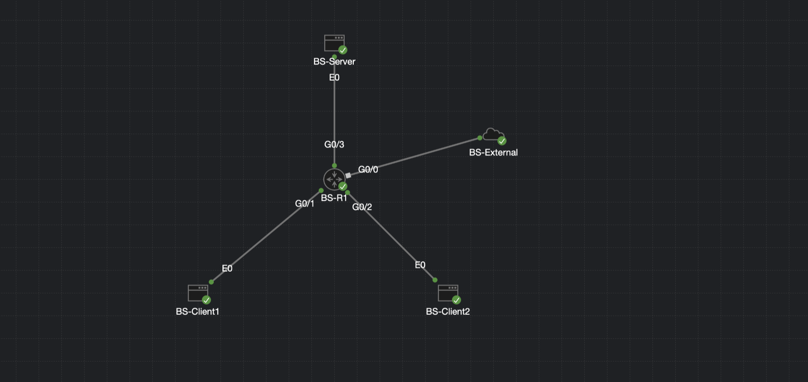
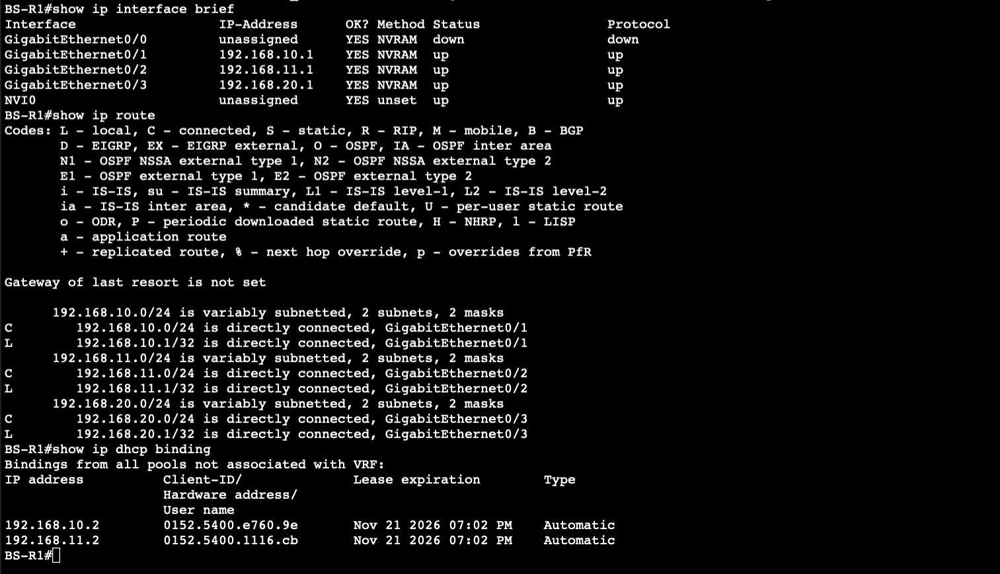
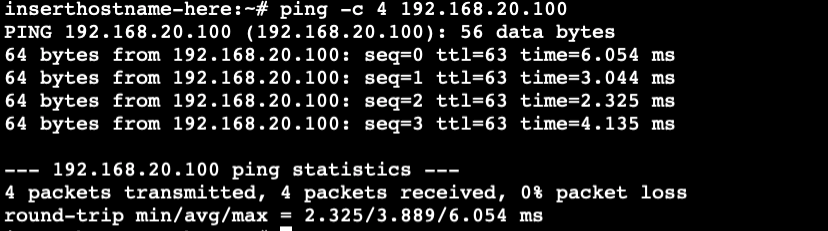
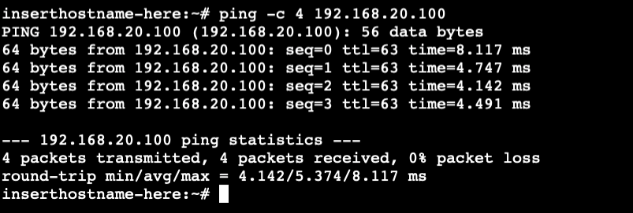
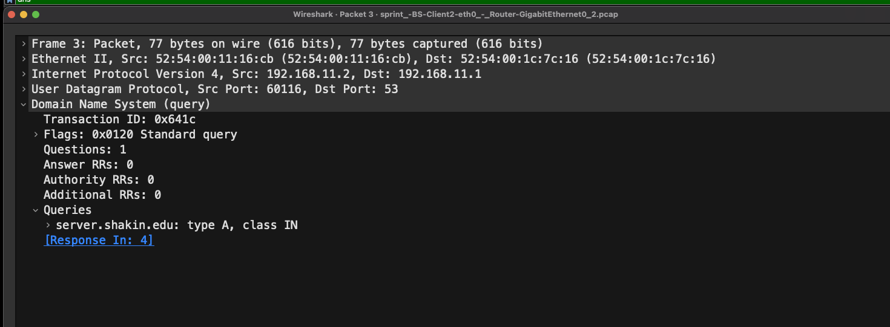
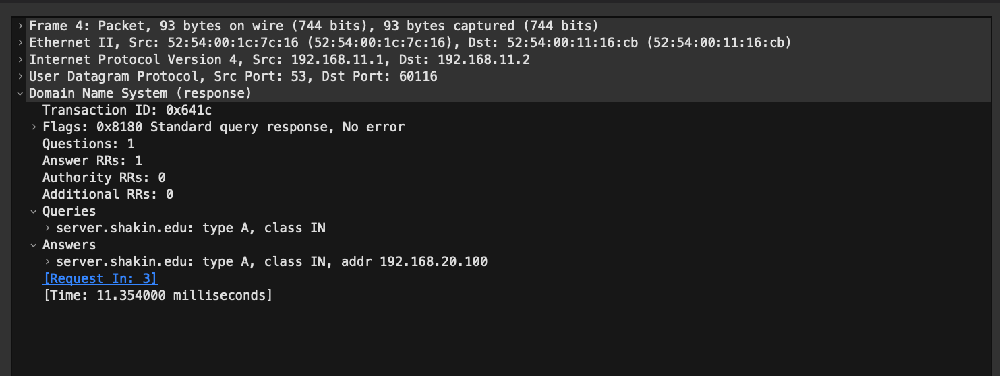

# Sprint 4 Network Verification Report

## 1. Network Overview
For Sprint 4, I created a network in Cisco Modeling Labs using one router, two clients and a game server. Each device is connected to a different subnet throgh the router. I configured the router to provide DHCP and DNS services so the clients could automatically recieve IP adresses and resolve the game servers hostname. I also tested communication between the clients and the game server to verify that routing was working correctly.

## 2. Network Topology
The berwork consists of three seperate subnets connected through router BS-R1. Client 1 uses the 192.168.10/24 subnet Client 2 uses the 192.168.11.0/24 subnet, and the game server uses the 192.168.20.0/24 subnet. The router acts as the default gateway for each subnet, allowing communication between the devices. 

## 3. Router Verification 

## Router Interfaces
I used the show ip interface brief command to verify the routers interfaces and ip addresses. The three internal interfaces, Gi0/1, Gi0/2, and Gi0/3, were all up and working correctly. Each interface was assigned an ip address for its corresponding subnet.

The routing table shows all three subnets as directly connected to BS-R1, so no static routes are needed between them. the DHCP bindings also confirm that Client 1 recieved 192.168.10.2 and client 2 recieved 192.168.11.2

## 4. Network connectivity 
I tested the connection between both clients and the game server using the ping command. Both clients were able to communicate with the game server at 192.168.20.100 with 0% packet loss. This confirms that the router succesfully forwarding packets between the different subnets.

### Client 1 Ping

### Client 2 Ping

## 5. DNS Verification
I configured BS-R1 to act as the DNS server for both clients. I created a DNS record that maps server.shakin.edu to the game servers IP address, 192.168,20.100. Using the bslookup command, I verified tat Client 2 could succesfully resolve the hostname to the correct IP address.

### DNS Query

### DNS Response

The DNS query was sent from client 2 to the router using UDP port 53. The router responded with the correct IP address of 192.168.20.100. Both packets had the same transaction ID, confirming that the response matched the original request.

## 6. External Connectivity

I aded an ecternal connector in NAT mode and connected it to the interface Gi0/0 on BS-R1. I configured the interface to use DHCP and marked it as the outside interface for NAT. However, Gi0/0 remained down even after restarting the router, recreating the connection, and replacing the External Connector. Because of this, I was unable to verify external netwrok connectivity.

## 7. Conclusion

In this sprint, I Succesfully condifured three subnets connected through one router. Both clients recieved their IP addresses through DHCP and were able to communicate with the game server. I also configured DNS and verified the hostname resolution using WireShark. The internal network worked correctly, but external connectivity remained unsolved.